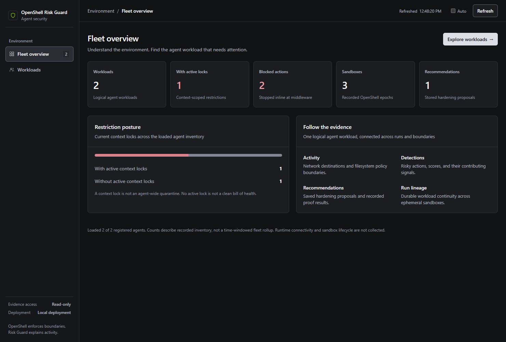
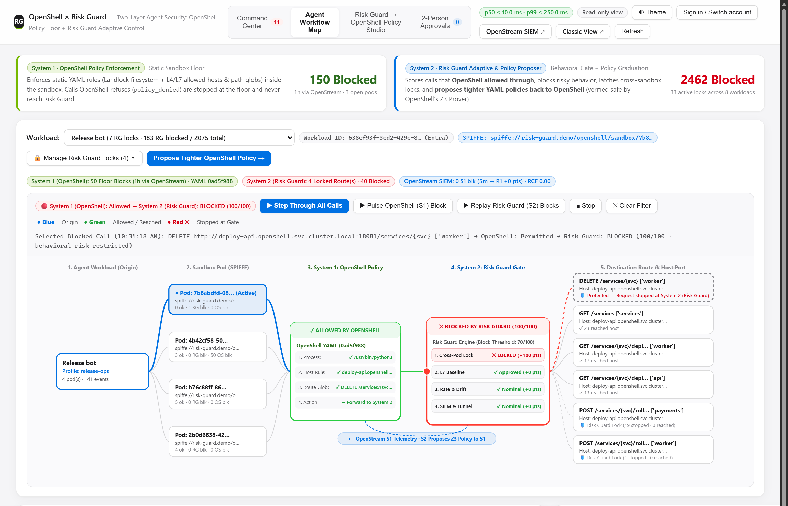
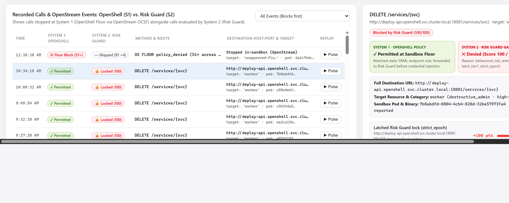
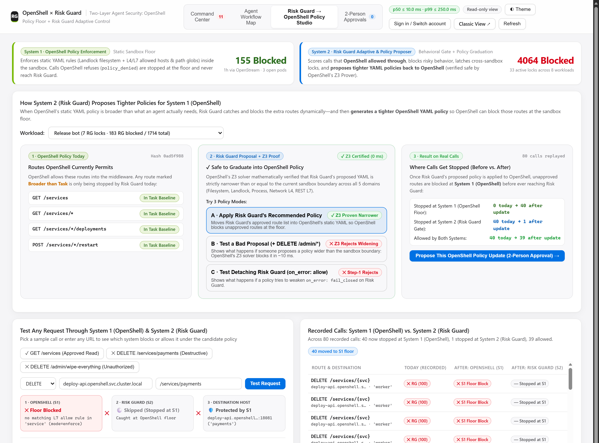

<!--
SPDX-FileCopyrightText: Copyright (c) 2026 Christopher Hanna.
SPDX-License-Identifier: Apache-2.0
-->

# OpenShell Behavioral Risk Guard (`openshell-risk-guard`)

## Status

Risk Guard runs end to end with a real OpenShell gateway, supervisor and sandbox.
It scores every inspected request, enforces denials before credentials are injected,
carries restrictions across sandboxes for the same workload, learns each workload's
normal behavior automatically in shadow mode, and records an explainable decision
for everything it evaluates. The gateway-to-sidecar channel is TLS with
gateway-signed JWTs, and the restriction state survives restarts. It is ready to
evaluate against your own OpenShell deployment and to extend.

What remains is validation on real traffic. Detection results so far come from
synthetic episodes, and the local demo uses scripted traffic, so tune thresholds
from your own captures before enforcing broadly. Details are in
[Evidence and limits](#evidence-and-limits).

## See it work

The operator console, captured from a live run against a real OpenShell gateway and sandbox
(the upstream is a harmless local fixture).



**Activity** follows one workload across its sandboxes to each destination. The risky `DELETE` is
stopped inline while the allowed `GET`s pass.



**Detections** explain every score: the signals behind it, the thresholds, and the persisted
cross-sandbox lock that carried the restriction to a new sandbox. An operator can clear a lock with an
audited reason.



**Adaptive** learns each workload's normal behavior automatically in shadow mode. It never blocks
until an operator reviews and promotes a model.



## At a glance

Risk Guard is a **sidecar** to the OpenShell gateway. OpenShell decides what an
agent is *permitted* to do; Risk Guard decides whether a permitted request is
*reasonable for this agent right now*, and can only narrow OpenShell's answer:
`FinalAllow = OpenShellAllow ∧ RiskPermit`. It plugs into OpenShell's own
extension points (`SupervisorMiddleware` before credentials are injected,
`GatewayInterceptor` on policy changes) and keeps its own SQLite state. It never
proxies traffic, stores secrets, or writes OpenShell policy.

## Why Risk Guard for OpenShell Users: Closing the Authorized-Endpoint Gap

- **The OpenShell Foundation:** Kernel Landlock filesystem confinement, process isolation, static L4/L7 Rego network policies, credential injection only for approved endpoints, and Z3 formal verification (`openshell-prover`) on policy changes.
- **The Authorized-Endpoint Gap:** An AI agent needs real API permissions (e.g., `api.github.com`, internal billing, cloud APIs) to do its job—or starts with a broader Day-1 policy while a team discovers what routes it needs. Within those permitted endpoints, an agent can still perform a destructive action outside its task (`DELETE /repos/org/payments-prod`), rapidly enumerate 50+ resources in 60 seconds, or retry a blocked action when an orchestrator spins up a fresh sandbox container.
- **How Risk Guard Complements OpenShell:**

| Layer | NVIDIA OpenShell (Governed Runtime) | OpenShell Risk Guard (Behavioral & Task-Aware Sidecar) | How They Work Together |
|---|---|---|---|
| **Enforcement Boundary** | Kernel Landlock, process rules, static L4/L7 network policy, and credential injection. | Inline `SupervisorMiddleware` (`PRE_CREDENTIALS`) + `GatewayInterceptor` (`VALIDATE` / `POST_COMMIT`). | **Strictly attenuating (`FinalAllow = OpenShellAllow ∧ RiskPermit`):** Evaluates requests *after* static policy allows them and *before* credentials are injected. Never widens OpenShell's boundary. |
| **Workload Continuity & State** | Per-sandbox container/microVM isolation (`sandbox_id`), plus external IAM/Entra credential injection. | Durable **Agent Workload ID** (`agent_id` / `openshell.nvidia.com/agent-id`) and scoring context persisted in SQLite (`WAL + FULL`). | **Cross-sandbox continuity (distinct from IAM/Entra identity):** While OpenShell isolates individual containers and injects external credentials at the boundary, Risk Guard maps ephemeral sandboxes back to the same logical **Agent Workload**. If a workload triggers a Tier-1 lock or Tier-2 cooldown in Sandbox A, spinning up Sandbox B for the same workload inherits the restriction immediately. |
| **Day-1 to Day-N Policy Lifecycle** | Enforces active YAML policy and runs `openshell-prover` on proposed edits. | Observes allowed traffic, learns normal rate/fan-out envelopes in **Auto-Shadow** mode, and synthesizes least-privilege YAML candidates with a **Two-Step Z3 Containment Proof**. | **Safe progressive hardening:** Teams can start with a broader policy, catch task deviations inline, and export a prover-verified tightened OpenShell policy once behavior stabilizes. |
| **Operator Experience** | CLI (`openshell`), SDKs, and gateway control plane. | Operator console (default `http://127.0.0.1:8791`), live SQLite Guardrail tuning, audited UI/CLI lock recovery, and Prometheus `/metrics`. | Gives security/platform teams fleet-wide visibility into *why* agents make requests, instant threshold/mode tuning, and audited false-positive recovery. |

## Terminology

| Term | Meaning |
|---|---|
| **Workload ID** | The durable identity of a logical agent workload across runs and ephemeral sandboxes. It selects which restrictions, baseline and learning history apply. It carries no credentials, and a sandboxed process can neither assert nor change it. It is established one of two ways: **derived** from the creating workspace and the principal the gateway authenticated (`--workload-from-principal`, so it cannot be forged), or an **operator label** (`--agent-id` or the `openshell.nvidia.com/agent-id` annotation), which is an assertion. Stored as `agent_id`. |
| **Principal** | The authenticated operator or user OpenShell reports for a call, with the identity provider that vouched for it (`oidc`, `cloudflare_access`, `mtls`, or the unauthenticated `local_dev`). Allowlisted principals decide which sandboxes are bound to which workload ID. With `--workload-from-principal`, the workload is derived from the creating workspace and principal instead. |
| **Workspace** | OpenShell's isolation boundary for sandboxes, providers and policies. Derived workloads, auto-registered labels and `agent-register --workspace` workloads are scoped to one, so a sandbox from another workspace cannot bind to them. Not to be confused with a workload, or with the `/sandbox` directory. |
| **Sandbox**, **epoch** | An ephemeral OpenShell sandbox and the policy epoch it runs under. |
| **Run** | One execution of a workload, bound to its sandboxes. Many runs share one workload ID. |

"Workload" is the user-facing term. Machine names keep `agent` (the `agent_id` column,
`--agent-id`, `agent-register`, `/api/agents/...`) so existing data and tooling keep working.
Where this document says "the sandboxed process", it means the program running inside a sandbox.

## Evidence and limits

- **Detection numbers come from synthetic fixtures** (415 episodes) written for this
  project. They show the scoring logic does what it was designed to do, not
  real-world accuracy. Real validation means captures from a real OpenShell
  deployment: chronological held-out runs per workload, measured false denials, plus a red-team
  set (encoding variants, mimicry of normal tools, slow-and-low enumeration).
- **One gateway, one writer.** A single SQLite writer is what makes the ratchet
  durable and linearizable. Move to a shared store only when you need several
  gateway replicas or exceed measured single-writer throughput.
- **Network only.** Risk Guard scores HTTP/S requests that OpenShell inspects.
  Filesystem and process behavior are enforced statically by OpenShell
  (Landlock and policy), not scored.
- **Bodies and headers are received but never used.** OpenShell's middleware call
  delivers the request body, headers and query (up to the registered
  `max_payload_bytes`). Risk Guard discards them unread and never stores or logs
  them. Routes whose effect depends on the body (GraphQL, unknown POSTs) are treated
  as high-impact by default. OpenShell treats an oversized payload as a middleware
  failure, so Risk Guard advertises and is registered for the 4 MiB platform maximum;
  a large body is never denied just for its size.
- **Single local operator.** The console uses one private capability token, not
  per-user accounts; its audit records the capability, not a person.
- **Raw resource names** (for example `org/payments-prod`) are stored for operator
  explanations. The database is owner-only (`0600`). Put it on an encrypted volume.

## Quickstart

Run the synthetic test, benchmark and 10-step end-to-end suite (no OpenShell gateway needed):

```bash
./scripts/demo.sh
```

For a narrated walkthrough with pauses between stages:

```bash
./scripts/demo.sh --interactive
```

To run against a real OpenShell gateway and sandbox, use the local demo stack in
[Demo and local deployment](docs/demo.md).

### Operator CLI commands

```bash
# 1. Start the unified gRPC sidecar (SupervisorMiddleware + GatewayInterceptor).
#    TLS, the HMAC key and the gateway's JWT public key are required; see
#    docs/operations.md. For a single-user loopback test only, replace the three
#    secret flags with --allow-insecure-local-test.
cargo run -- serve \
  --listen 127.0.0.1:50061 \
  --db /tmp/risk-guard.db \
  --gateway-id local-gateway \
  --audience urn:openshell:extension:risk-guard \
  --public-key-pem /path/to/gateway-public.pem \
  --tls-cert /path/to/tls.crt --tls-key /path/to/tls.key \
  --hmac-key-file /path/to/hmac.key

# 2. Create/bind a governed policy epoch for a sandbox
cargo run -- epoch-create \
  --db /tmp/risk-guard.db \
  --sandbox-id sbx-demo-01 \
  --task-profile repo-triage-readonly \
  --mode enforce \
  --policy ./policy.yaml

# 3. Inspect recorded explainable risk decisions for a sandbox
cargo run -- decision-inspect \
  --db /tmp/risk-guard.db \
  --sandbox-id sbx-demo-01 \
  --limit 10

# 4. Generate a prover-verified least-privilege hardening recommendation
cargo run -- hardening-report \
  --db /tmp/risk-guard.db \
  --sandbox-id sbx-demo-01 \
  --policy ./policy.yaml \
  --out /tmp/hardening-recommendation.json
```

## Documentation

| Read | For |
|---|---|
| [Operating Risk Guard](docs/operations.md) | TLS and secrets, bootstrap order, protecting a new API, recovering from a false positive, metrics, rollout |
| [Security model](docs/security-model.md) | How the sidecar sits next to OpenShell, workload ID continuity, trust boundaries, measured release gates |
| [Running on AKS](docs/aks.md) | Deploy OpenShell and Risk Guard on Azure Kubernetes Service with scripts: Kata VM sandboxes, Key Vault credentials, Entra agent identities, a protected public console, and what a real cluster showed |
| [Demo and local deployment](docs/demo.md) | Running the local demo stack and its traffic generator |
| [Requirements](docs/requirements.md), [Design](docs/design.md), [Anomaly detection](docs/anomaly-detection.md) | Specifications and the scoring model |

## Building

`openshell-risk-guard` depends on crates from [NVIDIA OpenShell](https://github.com/NVIDIA/OpenShell) by relative
path. Clone both repositories side by side, then build:

```bash
git clone https://github.com/NVIDIA/OpenShell.git
git clone https://github.com/ChrisHanna/openshell-risk-guard.git
cd openshell-risk-guard && cargo build --locked
```

## License

Apache-2.0. See [LICENSE](LICENSE). This is an independent project and is not affiliated with or endorsed by NVIDIA.
