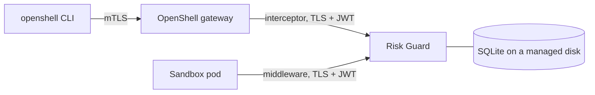

# Running OpenShell with Risk Guard on Azure Kubernetes Service

This guide deploys an OpenShell gateway on AKS from its Helm chart and runs Risk Guard beside it as an
operator-run extension (gateway interceptor and supervisor middleware). Optionally, sandboxes run in
Kata VM isolation. The scripts live in [`scripts/aks/`](../scripts/aks) and the manifests in
[`deploy/aks/`](../deploy/aks).

> **Cost.** The defaults (two `Standard_D2s_v5` nodes and a Basic registry) cost roughly 10 USD per day.
> A Kata node pool (one `Standard_D4s_v5`) adds roughly 5 USD per day. These are estimates, not quotes.
> Run `scripts/aks/99-teardown.ps1 -Yes` when you are done: it deletes the whole resource group.

## What you get



* **OpenShell** is installed from the chart in your OpenShell checkout, with images from
  `ghcr.io/nvidia/openshell` at the checkout's commit.
* **Risk Guard** runs as its own Deployment (one replica, `Recreate` rollout, because it is a single-writer
  SQLite store) with a read-only console container on the pod's loopback.
* **Binding:** Risk Guard runs with `--workload-from-principal`, so each sandbox binds to a workload derived
  from its workspace and the principal the gateway authenticated. See [operations](operations.md).

## Prerequisites

* An Azure subscription where you can create AKS clusters, and the Azure CLI signed in (`az login`).
* `kubectl` and Helm 3.14+ (or 4).
* PowerShell 5.1 or 7+ (the scripts also run on Linux and macOS with `pwsh`).
* A checkout of [NVIDIA/OpenShell](https://github.com/NVIDIA/OpenShell) next to this repository, or pass
  `-OpenShellPath`. Risk Guard builds against it, so use the same commit you deploy.
* For Kata: a region and subscription quota for a Gen2 VM size that supports nested virtualization
  (for example `Standard_D4s_v5`).

## Steps

Run from the repository root. Each script is idempotent, saves resource names to `.aks/state.json`
(git-ignored, never secrets), and prints the next step.

| Step | Script | What it does |
|---|---|---|
| 1 | `scripts/aks/01-create-environment.ps1` | Resource group, container registry and AKS cluster (Azure Linux, Cilium so NetworkPolicy is enforced, OIDC issuer and workload identity). |
| 2 | `scripts/aks/02-build-image.ps1` | Builds the Risk Guard image **in Azure** with `az acr build`; no local Docker needed. |
| 3 | `scripts/aks/03-install-openshell.ps1` | Pinned Agent Sandbox controller, then the OpenShell chart. Add `-RuntimeClass kata-vm-isolation` for Kata. |
| 4 | `scripts/aks/04-deploy-risk-guard.ps1` | Generates TLS and HMAC secrets inside the cluster, writes them straight to Kubernetes Secrets, deploys Risk Guard. |
| 5 | `scripts/aks/05-register-extension.ps1` | Registers Risk Guard with the gateway (Helm values overlay). The gateway restarts. |
| 6 | `scripts/aks/06-add-kata-pool.ps1` | Optional Kata node pool (`KataVmIsolation`). |
| 7 | `scripts/aks/connect-gateway.sh` | Registers the gateway with the `openshell` CLI over mTLS. |
| 8 | `scripts/aks/08-deploy-fixture.ps1` | Optional harmless test fixture and a small workload image with curl. |
| 9 | `scripts/aks/07-verify.ps1` | Prints workloads, who bound each sandbox, and recent decisions. |
| – | `scripts/aks/99-teardown.ps1 -Yes` | Deletes the resource group. |

The gateway validates every registered extension when it starts, so Risk Guard (step 4) must be running
before step 5.

## Try it

```bash
# a sandbox that calls the in-cluster fixture; the policy permits both calls
openshell sandbox create --name try1 --from <acr>.azurecr.io/openshell-demo/workload:1 \
  --policy deploy/aks/sandbox-policy.yaml --no-auto-providers --no-tty --detach -- /usr/bin/sleep infinity
openshell sandbox exec --name try1 --no-tty -- /usr/bin/curl -s -o /dev/null -w '%{http_code}\n' \
  http://risk-guard-fixture.openshell.svc.cluster.local:18081/repos/local/review/issues        # 200
openshell sandbox exec --name try1 --no-tty -- /usr/bin/curl -s -o /dev/null -w '%{http_code}\n' -X DELETE \
  http://risk-guard-fixture.openshell.svc.cluster.local:18081/repos/local/production            # 403, denied by Risk Guard
pwsh scripts/aks/07-verify.ps1
```

## Security notes

* Risk Guard gets only the gateway's **public** extension-signing key (a projected `public.pem`); the signing
  key in the same Secret is never mounted into it.
* TLS keys and the HMAC key are generated in-cluster and stored only as Kubernetes Secrets. Treat the Secret
  store as the trust boundary (enable AKS encryption at rest and restrict `get secret` in `openshell`).
* The chart's default client certificate is a single shared identity (`openshell-client`, provider `mtls`),
  so everyone using it shares one derived workload. For real per-person identity, configure OIDC
  (Microsoft Entra ID works) on the chart: the principal then comes from each user's token.
* OpenShell's unauthenticated local-development user is refused by Risk Guard unless you pass the
  local-testing-only `--allow-local-dev-principal`. These manifests do not.

## Kata VM isolation

AKS Pod Sandboxing runs a pod in its own lightweight VM with a dedicated guest kernel. OpenShell exposes it
through `server.defaultRuntimeClassName` (or a per-sandbox `runtime_class_name`). OpenShell also requires
**Landlock ABI 3 or newer (Linux 6.2+) inside the sandbox** and fails closed if it cannot enforce it.
Whether the Kata guest kernel provides that is the open question; the results are recorded in
[Findings](#findings).

## Findings

_Recorded from running these scripts on a real cluster. See the end of this document._
