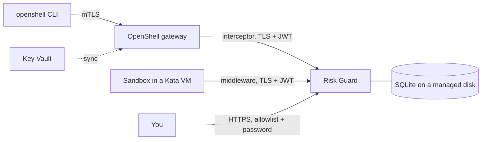

# Running OpenShell with Risk Guard on Azure Kubernetes Service

This guide deploys an OpenShell gateway on AKS from its Helm chart and runs Risk Guard beside it as an
operator-run extension (gateway interceptor and supervisor middleware). Sandboxes can run in Kata VMs. Everything
here was run on a real cluster; the [Findings](#findings) section records what worked and what did not.

The scripts live in [`scripts/aks/`](../scripts/aks) and the manifests in [`deploy/aks/`](../deploy/aks).

> **Cost.** The defaults (two `Standard_D2s_v5` nodes and a Basic registry) cost roughly 10 USD per day. The Kata
> pool (one `Standard_D4s_v5`) adds roughly 5 USD per day, and the public console adds a small load-balancer charge.
> These are estimates, not quotes. Run `scripts/aks/99-teardown.ps1 -Yes` when you are done: it deletes the resource group.

## What you get



* **OpenShell** is installed from the chart in your OpenShell checkout, with images from `ghcr.io/nvidia/openshell` at the
  checkout's commit.
* **Risk Guard** runs as its own Deployment (one replica, `Recreate` rollout, because it is a single-writer SQLite store)
  with a read-only console on the pod's loopback. It binds each sandbox to a workload derived from the workspace and the
  principal the gateway authenticated, or to a workload named by an allowlisted label such as an agent's Entra application ID.
* **Kata** sandboxes run in their own VM with an upstream guest kernel that provides the Landlock OpenShell requires.

## Prerequisites

* An Azure subscription where you can create AKS clusters, and the Azure CLI signed in (`az login`).
* `kubectl` and Helm 3.14+ (or 4). PowerShell 5.1 or 7+ (the scripts also run on Linux and macOS with `pwsh`).
* A checkout of [NVIDIA/OpenShell](https://github.com/NVIDIA/OpenShell) next to this repository, or pass `-OpenShellPath`.
  Risk Guard builds against it, so use the same commit you deploy.
* For the Kata pool: quota for a Gen2 VM size with nested virtualization (for example `Standard_D4s_v5`).
* The `openshell` CLI (Linux or macOS; on Windows use WSL) to create sandboxes.

## Steps

Run from the repository root. Each script is idempotent, saves resource names to `.aks/state.json` (git-ignored, never
secrets), and prints the next step. Windows PowerShell 5.1 and PowerShell 7 are both supported.

| Step | Script | What it does |
|---|---|---|
| 1 | `01-create-environment.ps1` | Resource group, container registry and AKS cluster (Azure Linux, Cilium so NetworkPolicy is enforced, OIDC issuer and workload identity). Re-attaches the registry every run. |
| 2 | `02-build-image.ps1` | Builds the Risk Guard image **in Azure** with `az acr build`; no local Docker needed. Queues, then polls. |
| 3 | `03-install-openshell.ps1` | Pinned Agent Sandbox controller, then the OpenShell chart. Keeps earlier values on upgrade. `-RuntimeClass kata-qemu` runs every sandbox in Kata. |
| 4 | `04-deploy-risk-guard.ps1` | Generates TLS and HMAC secrets inside the cluster, writes them straight to Kubernetes Secrets, deploys Risk Guard. |
| 5 | `05-register-extension.ps1` | Registers Risk Guard with the gateway (Helm values overlay). The gateway restarts. |
| 6 | `06-add-kata-pool.ps1` | Kata node pool. Default mode installs **upstream Kata** with kata-deploy and approves the RuntimeClass for OpenShell. |
| – | `connect-gateway.sh` | Registers the gateway with the `openshell` CLI over mTLS (untested as a script; see below). |
| 8 | `08-deploy-fixture.ps1` | Harmless test fixture and a small workload image with curl. |
| 7 | `07-verify.ps1` | Prints workloads, who bound each sandbox, and recent decisions. |
| 9 | `09-expose-console.ps1` | Publishes the console on the internet behind an IP allowlist, a Let's Encrypt certificate and a password. |
| 10 | `10-create-key-vault.ps1` | Key Vault (RBAC, purge protection, firewalled to your address). |
| 11 | `11-set-secret.ps1` | Stores a secret from a hidden prompt, through a protected temp file that is overwritten and deleted. |
| 12 | `12-sync-credentials.ps1` | Copies a Key Vault secret into an OpenShell provider over stdin. |
| 13 | `13-register-agent-identity.ps1` | Registers an Entra application for an agent; its client secret goes only to Key Vault; its application ID becomes a workload. |
| 14 | `14-build-agent-image.ps1` | Builds the NeMo Agent Toolkit agent image in the registry. |
| – | `99-teardown.ps1 -Yes` | Deletes the resource group. |

The gateway validates every registered extension when it starts, so Risk Guard (step 4) must be running before step 5.
After redeploying Risk Guard with step 4, re-run steps 9 and 13: they patch the deployment, and a fresh apply resets
those fields.

## Try it

```bash
openshell sandbox create --name try1 --from <acr>.azurecr.io/openshell-demo/workload:1 \
  --policy deploy/aks/sandbox-policy.yaml --no-auto-providers --no-tty --detach -- /usr/bin/sleep infinity
openshell sandbox exec --name try1 --no-tty -- /usr/bin/curl -s -o /dev/null -w '%{http_code}\n' \
  http://risk-guard-fixture.openshell.svc.cluster.local:18081/repos/local/review/issues        # 200
openshell sandbox exec --name try1 --no-tty -- /usr/bin/curl -s -o /dev/null -w '%{http_code}\n' -X DELETE \
  http://risk-guard-fixture.openshell.svc.cluster.local:18081/repos/local/production            # 403, denied by Risk Guard
pwsh scripts/aks/07-verify.ps1
```

To give an agent its own workload from its Entra identity, add
`--annotation openshell.nvidia.com/agent-id=<application id>` (step 13 prints it).

## Credentials

* **Where they live.** Agent credentials are stored in OpenShell's provider store, encrypted with a key held in a cluster
  Secret. A sandbox receives an opaque placeholder; OpenShell substitutes the real value only on requests to the hosts,
  paths and binaries the provider profile allows.
* **Key Vault is the system of record.** Set and rotate a secret there (`11-set-secret.ps1`), then copy it into the
  provider with `12-sync-credentials.ps1`. OpenShell cannot use Key Vault as its credential backend (it supports its own
  store, Kubernetes Secrets and HashiCorp Vault's API), so the value is copied; Key Vault keeps the access control, audit
  log and versions. The Secrets Store CSI driver is not an option for Kata pods in AKS Pod Sandboxing.
* **Never type a secret into chat or a command line.** Both scripts read hidden input or stdin.

## Security notes

* Risk Guard gets only the gateway's **public** extension-signing key (a projected `public.pem`); the signing key in the same
  Secret is never mounted into it.
* TLS keys and the HMAC key are generated in-cluster and stored only as Kubernetes Secrets. Treat the Secret store as the
  trust boundary (enable AKS encryption at rest and restrict `get secret` in `openshell`).
* The public console has no login of its own, so it is only exposed through the proxy in step 9: a source-IP allowlist,
  a browser-trusted Let's Encrypt certificate (issued and renewed by a lego sidecar), a generated password stored only as a
  hash in the cluster, and GET/HEAD only. Keep the allowlist tight. Port 80 is open to the internet so Let's Encrypt can
  validate the name; it serves only the challenge and redirects to HTTPS. Because one Service cannot restrict ports
  separately, nginx enforces the allowlist on 443 (the Service keeps the client address with `externalTrafficPolicy: Local`).
  The hostname appears in public certificate-transparency logs. Use `-AcmeStaging` to test without using the real limits.
* The chart's default client certificate is a single shared identity (`openshell-client`, provider `mtls`), so everyone
  using it shares one derived workload and can label sandboxes. For real per-person identity, configure OIDC (Microsoft Entra
  ID works) on the chart.
* OpenShell's unauthenticated local-development user is refused by Risk Guard unless you pass the local-testing-only
  `--allow-local-dev-principal`. These manifests do not.
* `kata-deploy` is a privileged installer. It is limited to nodes labeled `openshell.ai/kata=true` and pinned to a release.
* The Agent Sandbox controller is a cluster-wide CRD and controller from kubernetes-sigs, pinned to `v1.0.7`.

## Findings

What running this on a real AKS cluster showed (Kubernetes 1.36, OpenShell `0.1.5-dev.63`, Risk Guard from this repository).

**It works.** A sandbox was Ready in about 35 seconds. The allowed `GET` returned 200; the destructive `DELETE` returned
403 from Risk Guard although the static policy permits it. The sandbox was bound by the real mTLS principal, and a
second sandbox labeled with an agent's Entra application ID became its own workload.

**Kata: AKS Pod Sandboxing does not work with OpenShell; upstream Kata does.**

| | Guest kernel | Landlock | OpenShell |
|---|---|---|---|
| AKS Pod Sandboxing (`kata-vm-isolation`) | 6.6 (`mshv`) | not implemented (ENOSYS) | fails closed: *"Landlock ABI v3 or newer is required, but Landlock is not implemented (kernel lacks CONFIG_SECURITY_LANDLOCK)"* |
| Upstream Kata via kata-deploy (`kata-qemu`) | 6.18 | available | sandbox runs; allow and deny both enforced |

A normal (runc) AKS node reports Landlock ABI 3, which satisfies OpenShell, so Kata is optional hardening, not a requirement.
OpenShell also only schedules onto operator-approved RuntimeClasses: label the class `openshell.ai/sandbox-attachable=true`
or `CreateSandbox` fails with `FAILED_PRECONDITION` (step 6 does this).

**Bugs found and fixed by running it for real**

* The sidecar image failed to link on Debian 12: OpenShell's prebuilt Z3 needs glibc 2.38+ and libstdc++ 13+. The image now
  builds and runs on Debian 13.
* Kubernetes' built-in gRPC probe cannot speak TLS, so a TLS-only listener was killed by its own liveness probe. The sidecar
  has a `health-check` subcommand that does the call over TLS and is used as an exec probe.
* A client-certificate caller is a `user` principal from the `mtls` provider; the workload derivation now accepts it.
* A cluster create interrupted after the cluster existed left the registry unattached (401 on image pull). The script now
  re-attaches every run.
* Windows PowerShell 5.1 specifics: no `$IsLinux`, native-argument quote stripping, strict-mode property access, and flaky
  connection resets that the scripts retry.

**Also verified on the cluster**

* The sidecar's TLS health check: SERVING with the right certificate name, an error exit with a wrong one, and the pod stays up
  past its liveness window with no restarts.
* The NeMo Agent Toolkit agent image, running in a Kata VM as the workload named by the agent's Entra application ID: its
  interpreter's `GET` returned 200 and its `DELETE` returned 403, and the NeMo Agent Toolkit and NeMo Guardrails import cleanly.
* Key Vault to OpenShell provider sync (with a dummy secret), and an Entra application registration with its secret kept only in
  Key Vault.

**Not verified**

* `connect-gateway.sh` as a script. Its steps were done by hand. On Windows the CLI runs in WSL while kubectl runs on Windows,
  so the port-forward must be relayed to WSL's localhost.
* `11-set-secret.ps1` needs an interactive hidden prompt, so it was not run unattended. `12-sync-credentials.ps1` was verified
  with a dummy secret.
* The Entra provider profile minting tokens for a real protected API.
* Real OIDC principals: only the shared client-certificate identity was exercised on the cluster.

**Also verified later:** the agent makes live Nemotron calls through OpenShell with the key injected from Key Vault; three
agents, each with its own Entra application, run on a schedule and each shows in the console with its name next to its
application ID; the console serves a Let's Encrypt certificate that browsers trust.

**Operational lessons**

* A small Kata node fills up. Each sandbox is a VM, so leftover sandboxes make new ones sit in `Provisioning`. The fleet deletes
  each sandbox after its run and sweeps `agent-*` sandboxes older than 3 hours.
* The gateway connection from WSL is a `kubectl port-forward` and it drops now and then. A dropped `sandbox create` may still
  have created the sandbox, so `run-agent.sh` checks for it and retries before giving up.
* In a script with `set -e` and `pipefail`, a `grep` that finds nothing ends the script silently. Polling a sandbox's phase while
  it is still being scheduled hit this, so that line ends with `|| true`.
* Some networks reset the `az` client's connections to the ACR build service (`az acr build` fails with error 10054) while
  `curl` works. `02-build-image.ps1 -LocalDocker` builds with Docker and pushes to the registry instead.
* Docker Desktop can fail to start on stale unix-socket files (`sailor-ingest.sock`, `docker-secrets-engine\engine.sock`) left by
  an unclean shutdown. They cannot be deleted, but moving their folders aside lets Docker recreate them.
* A reasoning model needs a larger `max_tokens` and native tool calling, otherwise the ReAct reply is empty or fails to parse.

## Running a fleet of agents

`scripts/aks/agent-fleet.sh` runs three agents on a schedule so the console always has fresh, varied behavior to
score. Register each identity first (`13-register-agent-identity.ps1 -AgentName nat-agent`, then `release-bot` and
`ops-cleaner`; add `-SkipRiskGuardUpdate` after the first run).

| Agent | Behavior | Expected in Risk Guard |
| --- | --- | --- |
| `nat-agent` | read-only issue triage | stays low risk |
| `release-bot` | routine work, occasionally asks for a risky delete | score climbs, some denials |
| `ops-cleaner` | repeatedly asks to delete production or injects instructions | denied, then locked |

Every 3 to 5 minutes (`MIN_WAIT` and `MAX_WAIT` seconds) one agent runs one randomly chosen task. Every third run of
an agent is screened by the NeMo Guardrails input rail first (`--guardrails-every N`), so some requests are stopped
before they reach Risk Guard and others are stopped by it. Use `--once` for a single pass. Each sandbox is deleted
after its run, and every 3 hours (`SWEEP_EVERY` seconds) the fleet also removes any `agent-*` sandbox older than that, such as one left behind by a dropped connection, so the Kata node stays small.

```bash
export OPENSHELL_BIN=... ACR_SERVER=<registry>.azurecr.io
scripts/aks/agent-fleet.sh
```
