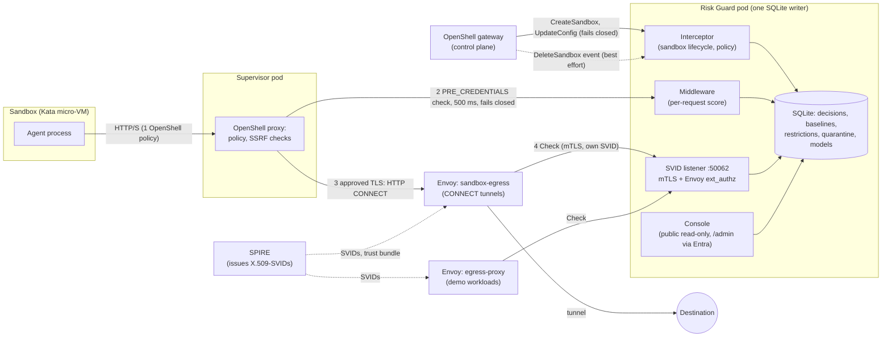

# Architecture

Risk Guard sits beside an OpenShell gateway. It never replaces OpenShell's policy; it adds a judgement about whether each request
is reasonable for the job the agent was given, remembers what each workload has done, and can be asked again at the network layer.

## What is on the request path

A request leaving a sandbox meets up to three gates, in this order. A later gate never sees a request an earlier one refused.

| # | Gate | Where it runs | What it decides on | If it cannot answer |
|---|---|---|---|---|
| 1 | **OpenShell policy** | Supervisor pod | The static policy: hosts, methods, binaries, credentials | Denies |
| 2 | **Risk Guard middleware** (`PRE_CREDENTIALS`) | Risk Guard, called by the supervisor | Method, host, route and a keyed resource name: is this reasonable for this workload's task? Restrictions that follow the workload. | Denies (500 ms timeout, fail closed) |
| 3 | **Tunnel gate** (`sandbox-egress`, an Envoy proxy) | On the network path, outside the sandbox and its supervisor | Which sandbox the connection came from (by pod address) and where it is going (the destination hostname, checked against the task's approved egress hosts). Refuses unknown sandboxes, quarantined workloads and, when enforced, unapproved destinations. | No tunnel (fail closed) |

Gate 1 and 2 run inside OpenShell's own enforcement point, the supervisor. Gate 3 does not: it is the part that still holds if the
supervisor is compromised, within the limits in [Workload identity](workload-identity.md).

The same Risk Guard decision logic also serves a second kind of caller, which is not an OpenShell sandbox: a workload that proves
its identity with a SPIFFE X.509-SVID over mutual TLS, directly or through an Envoy egress proxy that asks per request
(`egress-proxy`, demonstrated on the `egress-demo` workload).

## Components

| Component | Role | Where in the repository |
|---|---|---|
| Gateway interceptor | Sees sandbox creation and policy changes. Binds each sandbox to a workload from the creator's authenticated identity, keeps its policy within a prover-checked ceiling, keeps the Risk Guard middleware attached. Closes a sandbox's record on its delete event. | `src/interceptor_service.rs` |
| Middleware | Normalises each request, scores it against the workload's baseline and restrictions, returns allow or deny with reasons. Records its own decision time. | `src/middleware_service.rs`, `src/detector/` |
| Decision store | One SQLite file, one writer: decisions, epochs, baselines, restrictions, quarantine, adaptive models, latency. | `src/store/` |
| SVID listener | Second mutual-TLS listener. Identity comes only from a verified X.509-SVID. Also serves Envoy's external authorization (`Check`). | `src/spiffe.rs`, `src/ext_authz.rs` |
| Pod resolver | Turns a supervisor pod's address into its sandbox (read-only Kubernetes access to pods in one namespace). | `src/pod_resolver.rs` |
| Console | Public read-only view; sign-in with Microsoft Entra at `/admin` to change settings, clear restrictions. Prometheus metrics. | `src/operator_dashboard.rs`, `src/operator_ui.html` |
| Adaptive model | Learns each workload's normal behaviour from clean runs, in shadow only; promotion to enforce is manual. | `src/adaptive.rs` |
| Hardening recommender | Proposes a tighter OpenShell policy and proves it stays inside the current one. | `src/hardening/` |
| Fleet | Three scripted agents run in the cluster on random schedules to give Risk Guard real traffic. | `scripts/aks/agent-fleet.sh`, `deploy/aks/fleet.yaml` |

## Identity

Three sources, never mixed up:

* **OpenShell's gateway** tells Risk Guard who created a sandbox (a person or operator authenticated by OIDC or a client
  certificate). The workload is derived from `(workspace, principal)`, so a name cannot be forged or squatted. The sandbox's own
  calls are authenticated with a gateway-signed token for that sandbox.
* **SPIFFE** (SPIRE) names workloads that are not OpenShell sandboxes, and the Envoy proxies that vouch for them. The identity is the
  verified certificate, never a header.
* **A SPIFFE ID per sandbox** is issued by SPIRE through OpenShell's own support and used for provider token grants. Risk Guard records and
  displays it, labelled "assigned"; it does not receive the certificate, so it does not rely on it.
* **Pod address** names the sandbox behind a tunnel. OpenShell's proxy chaining sends no certificate, so the address is mapped to
  the sandbox through the supervisor pod's `openshell.ai/sandbox-id` label. It is only as strong as the network's refusal to
  forge source addresses.

## What it remembers, and where

Everything is in one SQLite database on a persistent volume, written by the one Risk Guard process. A restriction earned by a
workload follows it to new sandboxes. Sandboxes that were deleted keep their record; one not seen for six hours is shown as
"presumed gone", never rewritten. The console only reads.

## Failure behaviour

| What fails | Result |
|---|---|
| Risk Guard unreachable during a per-request check | The request is denied (fail closed) |
| Risk Guard unreachable during sandbox creation or a policy change | The change is refused (fail closed) |
| The `DeleteSandbox` event is missed | Nothing blocks; the sandbox shows as "presumed gone" after six hours |
| The tunnel proxy or its Risk Guard check is down | New TLS egress from sandboxes fails (fail closed) |
| The console is down | Enforcement is unaffected; only visibility is lost |
| The SQLite volume is lost | Baselines and history are lost; there is no replica (single writer) |

## What it does not do

* It sees method, host, route and a keyed resource name. Bodies, headers and query strings are discarded unread, so an attack that
  lives only there is invisible.
* Gate 3 sees a destination address and port, not a path (the tunnel is encrypted). OpenShell supports a TLS-intercepting upstream
  proxy, which would show paths; this deployment's Envoy does not do that. Gate 3 also cannot see traffic that does not go through
  the proxy; the network policies below close the direct routes, with one documented gap (a compromised supervisor can still reach
  in-cluster plain-HTTP services directly).
* A compromised supervisor that stops calling Risk Guard is not detected by gates 1 and 2. Gate 3 limits the damage only for workloads
  an operator quarantines, or for restrictions you choose to enforce.
* It is not a separate hardware trust domain (compare NVIDIA Sentry on a BlueField DPU). See [positioning](positioning.md).
* Detection has been measured on the author's own agents only. See [detection results](detection-results.md).

## Network policy in force (what stops a direct route)

Measured by `scripts/conformance/egress_bypass.py` (19 cases; reports in `conformance/`).

| Pod class | Policy | Effect |
|---|---|---|
| Agent (Kata workload pod) | `openshell-sandbox-workloads` (OpenShell creates and validates it; do not edit) | Egress denied; ingress only from its own supervisor on TCP 5500. The agent can reach nothing itself. |
| Supervisor | `openshell-sandbox-supervisors` (OpenShell) allows all egress; **`supervisor-egress-fence`** (ours, Cilium) denies the internet, the metadata address, the Kubernetes API, the SPIRE server and Risk Guard's SPIFFE port | Standard NetworkPolicies are additive and cannot narrow an allow-all, so the fence uses Cilium deny rules. The supervisor still reaches the gateway, Risk Guard's middleware port and the tunnel proxy. |
| Tunnel proxy (`sandbox-egress`) | `sandbox-egress` | Ingress only from supervisors; egress to Risk Guard and approved destinations. |
| SPIFFE demo workloads | `egress-demo-only-via-proxy` | Egress only through the per-request proxy. |

Limits: the fence needs Cilium (script 18 skips it with a warning otherwise). A supervisor that is compromised can still reach an
in-cluster plain-HTTP destination directly (the one `documented` case in the report). Network policy does not make the node pools
separate trust domains.

## Quarantine: what is guaranteed, and when

* **New tunnels:** refused immediately once the operator quarantine is written (Risk Guard re-reads it on every check).
* **Tunnels already open:** not cut at that instant. Envoy ends every tunnel after `max_stream_duration` (120 s), so the longest an
  existing connection can outlive a quarantine is 120 s. Measured: a long-lived connection failed 111.5 s after quarantine
  (`conformance/quarantine-tunnel*.json`).
* **What the client sees:** a refused new tunnel shows as a TLS handshake timeout after about 10 s, not an HTTP error.
* A short lifetime also bounds every legitimate long stream to 120 s; raise it deliberately if a workload needs more.

## Deployed shape (AKS)

One cluster, two node pools: the Kata node runs the sandboxes (as micro-VMs), the supervisors and Risk Guard; the ordinary pool runs
the Envoy proxies and the SPIFFE demo workloads (they need the SPIRE agent's socket, which a micro-VM cannot share). SPIRE lives in
the `openshell` namespace so its trust bundle can be mounted. Scripts `01`–`18` in
`scripts/aks` build it step by step; `17` adds SPIFFE identity and `18` the tunnel gate.
