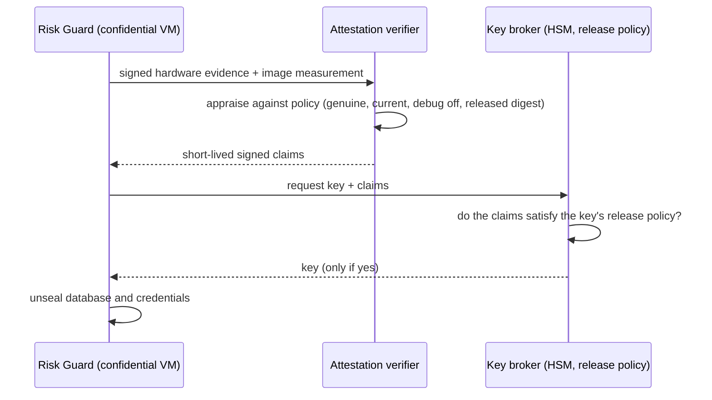

# Confidential computing: attestation-to-key-release design

> **Design only.** Nothing in this document is implemented or has been run. The current cluster uses ordinary VMs with Kata pod isolation, which
> is not confidential computing. No claim is made about a BlueField, DOCA or NVIDIA Sentry integration, or about a DOCA Tower connector.

## What problem it would solve

Today the host and the cloud operator can read Risk Guard's memory and database, and anyone with node access or Kubernetes administrator rights
can read what the pods mount. Confidential computing would let Risk Guard (and later the model it protects) run so that the host cannot read
or alter it, and would release secrets **only to a workload that proves what it is**, not merely to a pod that asks.

## The flow

The release of a key is conditioned on appraised evidence and policy, not on a pod's request for a secret.

1. **Boot.** Risk Guard starts in a hardware-protected VM (AMD SEV-SNP or Intel TDX). Its image digest is part of the measured state.
2. **Evidence.** The workload obtains a signed hardware report (CPU) and, where a GPU is in play, the GPU's own attestation report.
3. **Appraisal.** An attestation verifier checks the evidence against a policy: the hardware is genuine and current, debug is off, the
   measured image is the released digest (the one `scripts/release.py` records), and, for a GPU, confidential mode is on.
   The result is a short-lived signed token that states which claims held.
4. **Key release.** A key broker (for example a managed HSM with a secure-key-release policy) releases a key only to a token whose claims
   satisfy the key's policy.
5. **Unseal.** Risk Guard uses the key to open its database encryption key and its model-API credential. If the claims do not hold, there is no key,
   so the service cannot read its state and fails closed.
6. **Continuous appraisal.** Tokens are short-lived; a restart or a changed measurement requires a new appraisal.

## What it adds, by attacker

| Attacker | Effect |
|---|---|
| Compromised worker node | Cannot read Risk Guard's memory or database, and cannot obtain its keys. Today it can. |
| Kubernetes administrator | Can no longer read secrets from the pod or tamper with its image undetected (a changed image fails appraisal). Can still delete or stop it. |
| Cloud operator | Same as the node case, to the extent the hardware protection holds. |
| Compromised agent or supervisor | No change. This control does not address behaviour. |
| Policy administrator | No change; signed policy bundles and two-person approval are separate gaps. |

## What the repository would need

* Database encryption at rest with a key obtained through the flow above (today the database is a plain SQLite file on a managed disk).
* A verified-image policy using the release digest from `scripts/release.py`.
* A confidential node pool, a verifier, and a key broker, none of which exist in this deployment.
* A test that proves the negative: a modified image, or a non-confidential node, gets no key.

## Open points, to be checked before building

* Whether confidential containers on AKS are generally available, and in which regions and sizes, is unverified here.
* GPU confidential computing needs supported GPUs and quota; this deployment has no GPU nodes.
* OpenShell's own sandboxes may not run in a confidential guest (the managed Pod Sandboxing kernel lacked Landlock, which OpenShell requires). Risk Guard and
  the proxies are the realistic first candidates.
* If a flow is ever shown before it is real, it must carry a visible "simulated" label.

## A first step that would be honest

A spike on a small confidential VM pool: Risk Guard unseals its database key through an attestation-gated key release, and a negative test shows a tampered
image getting nothing. That is about a week of work once quota exists, and would turn this note into evidence.
