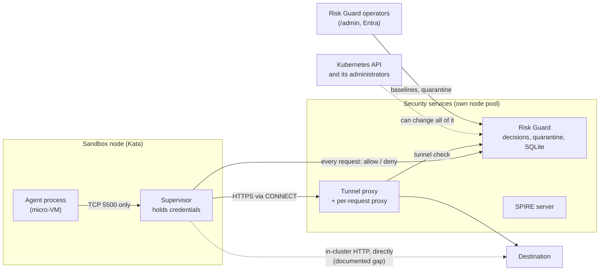

# Deployment security: who can do what

This page is the threat model for the AKS deployment: five attackers, what each one can reach, what stops them, and what does not. Each
claim names the evidence. Evidence is either an automated test, or a machine-readable report from a script in `scripts/conformance/`
run against the live cluster (reports in [`conformance/`](../conformance)). Where nothing stops an attacker, that is stated.

## Trust boundaries

Solid lines are enforced paths. The dotted lines are the two things the design does not stop.

## The five attackers

### 1. A compromised agent process

*The code running inside the sandbox: prompt-injected, or simply malicious.*

| Can it… | Result | Evidence |
|---|---|---|
| Reach anything itself | No. OpenShell's own policy denies the agent pod all egress except to its supervisor on TCP 5500 | `egress_bypass.py`: 8 of 8 agent cases, including internet, metadata, Kubernetes API |
| Make a request its policy lists, but one that is out of character | Scored by Risk Guard (the supervisor asks first); denied or restricted | [detection results](detection-results.md): 20 of 20 repeat and 6 of 6 first offences denied in the live run (small sample, the author's own agents) |
| Read Risk Guard's data or the Kubernetes API token | No token is mounted in sandbox pods, and the service accounts they use cannot read secrets or change anything | `placement.py`: sandbox pods with an API token: 0 of 7; 56 of 56 permission checks refused |
| Use a stolen destination credential | Not prevented. Credentials live in the supervisor; the agent only sees what the policy lets it send | [workload identity](workload-identity.md) (why a TLS-intercepting proxy was not built) |

### 2. A compromised supervisor

*The pod beside the agent that enforces policy and holds the credentials. It is far more powerful than the agent.*

| Can it… | Result | Evidence |
|---|---|---|
| Stop asking Risk Guard | **Yes.** Gates 1 and 2 (per-request scoring) depend on the supervisor calling Risk Guard; a supervisor that does not is not scored | stated limit, [architecture](architecture.md) |
| Stop reporting and keep using the network | Detected, not prevented: the tunnel gate flags a sandbox that reported before and has been quiet for ten minutes while opening tunnels (recorded in shadow; refused if the `supervisor_silent` rule is enforced). A supervisor that keeps sending harmless requests to look alive is not caught | `a_sandbox_whose_supervisor_has_gone_quiet_is_flagged_and_a_healthy_one_is_not` |
| Reach the internet, metadata, the Kubernetes API, the SPIRE server, or Risk Guard's identity port directly | No, after the Cilium fence (`supervisor-fence.yaml`). Before the fence it could reach all of them | `egress-bypass-before-fence.json` vs `egress-bypass-after-fence.json` |
| Reach an in-cluster plain-HTTP service directly | **Yes.** A supervisor legitimately forwards the agent's requests to those, so network policy cannot tell it from a bypass. One destructive request reached the destination in the test | the `documented` case in the after-fence report |
| Send HTTPS traffic out | Only through the tunnel proxy, which asks Risk Guard; refused for unknown sandboxes, quarantined workloads and (when enforcing) unapproved hosts | `svid_listener` tests; `egress_bypass.py` |
| Keep a tunnel open after the workload is quarantined | For at most 120 s, then Envoy ends it. Measured: 111.5 s and 81.4 s in two runs | `quarantine-tunnel-bounded.json` |

### 3. A compromised worker node

*An attacker who escapes a sandbox onto the node, or a node with a malicious kubelet.*

| Can it… | Result | Evidence |
|---|---|---|
| Read what pods on that node mount | **Yes.** Before hardening, Risk Guard (its database, its keys) and the SPIRE server ran on the same Kata node as the sandboxes. Now they run on a dedicated node | `placement-before-hardening.json`: 0 of 5 checks; `placement-after-hardening.json`: 5 of 5 |
| Read secrets of pods on *other* nodes | No, in a normal cluster: the node authorizer limits a kubelet to its own pods' secrets (Kubernetes behaviour, not tested here) | upstream Kubernetes |
| Reach Risk Guard over the network | Only on the same terms as any pod in the cluster | network policies, [architecture](architecture.md) |

The hardened placement profile moves Risk Guard, both proxies and the SPIRE server to their own tainted nodes
([ADR 0001](adr/0001-security-placement.md)) and is applied on the demo cluster. The nodes still share one control plane.

### 4. A Kubernetes administrator

*Anyone who can patch deployments, exec into pods or read secrets in the namespace.*

Nothing in this design stops them. They can change Risk Guard's image or arguments, read its keys, delete a network policy, or
release a quarantine from inside the pod. Node pools, taints and the permission checks do not change that, because all pools share one
control plane. What helps is outside this repository: Azure RBAC for Kubernetes with a small admin group, just-in-time elevation,
and audit logs on the API server. This is the largest gap if the platform team and the security team are different people, and the
reason the ADR lists a separate cluster as the production answer.

### 5. An administrator of the security service or its policy

*Someone who can sign in to `/admin`, edit baselines, release quarantines or change which rules enforce.*

| Can they… | Result | Evidence |
|---|---|---|
| Loosen a baseline or switch a rule from enforce to shadow | Yes, if they hold the operator role. Baseline edits are stored as numbered revisions, and quarantine and release are written to an audit table with operator and reason | `agent_guardrail_revisions`, `workload_quarantine_audit`; `agent_guardrails` test |
| Do it without a second person approving | Yes. There is no two-person rule | not implemented |
| Do it anonymously | No: the console's `/admin` requires an Entra sign-in; the public view is read-only | `tests/adaptive_ui_contract.cjs`, [operations](operations.md) |

## What happens when the security service itself fails

Measured in [`conformance/failure-containment.json`](../conformance/failure-containment.json) (`scripts/conformance/failure_containment.py`):
seven live cases against the per-request proxy, and six cases tied to named automated tests (disk write failure, invalid or expired token,
unknown identity, bad certificate, unknown sandbox). A denial is reported as either a **policy denial** (Risk Guard answered, with a
reason) or a **transport failure** (nobody answered); both block, and a destructive request never reached the destination in any case.

## Summary of the gaps

1. A supervisor that stops calling Risk Guard is not scored, and can reach in-cluster plain-HTTP services directly.
2. The security nodes share a control plane with the sandbox nodes; re-applying scripts 17/18 moves the proxies back until script 21 is re-run.
3. A Kubernetes administrator is outside what this design defends against.
4. Policy changes have no second-person approval.
5. Detection numbers come from the author's own agents; they show the mechanism works, not how it generalises.
