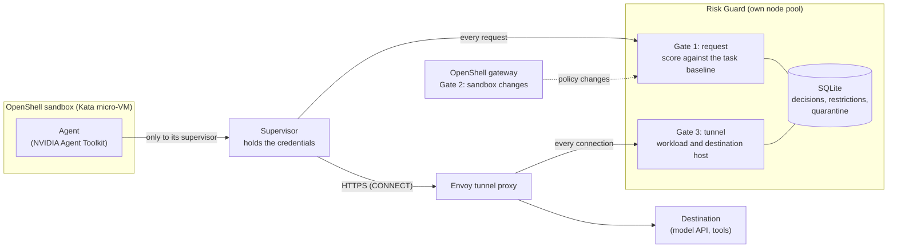

# Partner demonstration: stopping an agent without trusting it

For the full ten-minute run-of-show (story, Controls, the SIEM, Approvals, red team), see the [demo runbook](demo-runbook.md). This page is its 90-second core.

One scenario, about 90 seconds, run against the real deployment. Nothing in it is simulated: every line on screen comes from the running
system, and the same commands are in [`scripts/demo/run_demo.py`](../scripts/demo/run_demo.py). The other pages in this pack:
[results sheet](results-sheet.md) · [sizing and cost](sizing-and-cost.md) · [production gaps](production-gaps.md) ·
[confidential-computing design](confidential-computing-design.md).

## The story

An AI agent runs inside an OpenShell micro-VM sandbox. It does its job, then, because of a bad instruction or a hijacked tool, it starts
doing something it should not. Risk Guard is an extra, separate decision-maker on the path: it scores each action against what this task is
meant to do, refuses the dangerous one, remembers that it did, and lets an operator cut the network for the whole workload. The point
to land: **the control sits outside the agent and outside the supervisor's say-so**, and every claim has a report behind it.

## Where it sits

The standalone version for slides is [`images/risk-guard-architecture.svg`](images/risk-guard-architecture.svg).

## The 90 seconds

Run `scripts/demo/run_demo.py --pause` so each act waits for Enter. Before the meeting, run it once with `--prepare` (about a minute) to create
the standing sandbox for act 3.

| Time | On screen | Say | What it proves |
|---|---|---|---|
| 0:00 | The console's fleet page, workloads working | "These agents run in micro-VM sandboxes. Risk Guard watches what they do, not what they say." | The system is live and multi-workload |
| 0:10 | **Act 1.** Two routine reads return 200; decision time shown | "Normal work is not slowed down: the decision costs a few milliseconds against a model call that takes seconds." | Median gate cost 5.5 ms ([benchmark](benchmark.md)) |
| 0:30 | **Act 2.** `DELETE /services/worker` returns 403 with a reason; the destination's own counter is unchanged | "Same agent, a destructive call. Refused with a stable reason, and the destination's counter shows it never arrived. Then the same refusal inside an OpenShell sandbox, as the security events a SIEM receives." | Zero effect at the destination, verified at the destination |
| 0:50 | **Act 3.** A connection from the sandbox succeeds, the operator quarantines the workload, the next connection times out | "The operator cuts the workload off. New connections stop at once. A tunnel already open ends within two minutes: we measured 81 and 112 seconds, and I won't claim instant." | Containment and its honest limit |
| 1:15 | **Act 4.** 156 recorded decisions are exported and replayed in a fresh store: all reproduced | "Every decision is reproducible from a file. That is how you audit it, or test a new policy against real history." | Deterministic, auditable decisions |
| 1:30 | The [results sheet](results-sheet.md) | "Everything I said links to a report with its limits, and here is what is not done yet." | Honesty, and the production-gap list |

A real run (unpaused) takes about 20 seconds, so there is room to talk. Captured output: [`demo-output-sample.txt`](demo-output-sample.txt).

## If something goes wrong

* **Cluster unreachable:** play the captured output and use the [results sheet](results-sheet.md) and reports. Say it is a recording.
* **Act 3 is slow or the sandbox is missing:** the script skips it and says so; narrate the measured report instead
  (`conformance/quarantine-tunnel-bounded.json`).
* **After the demo:** `scripts/demo/run_demo.py --cleanup` removes the sandbox and releases the quarantine.

## Questions to expect, and honest answers

| Question | Answer |
|---|---|
| Can a compromised agent bypass this? | Not by itself: its pod can reach only its supervisor, tested ([egress bypass](../conformance/egress-bypass-after-fence.json)). |
| A compromised supervisor? | It can stop calling Risk Guard, so per-request scoring is not guaranteed. The tunnel gate and network fence still limit it, and one in-cluster HTTP route stays open. This is stated, not hidden ([threat model](deployment-security.md)). |
| How fast, how much load? | 5.5 ms median for the gate; about 100 decisions/s per instance, failing closed past about 8 concurrent callers ([benchmark](benchmark.md)). |
| Why not a trained model? | The scorer is deterministic rules over a per-task baseline, so decisions are reproducible and explainable. Adaptive shadow learning exists but is not enforced. |
| Detection accuracy? | Small scripted samples on our own agents; no held-out set, and no probability claim ([detection results](detection-results.md)). |
| Where does NVIDIA hardware fit? | Design only: [confidential computing](confidential-computing-design.md). Nothing here claims a BlueField, DOCA or Sentry integration. |
| Is it production-ready? | No. [The gap list](production-gaps.md) says what is missing, in order. |

## Real, measured, and design-only

* **Real and run:** every act above; the reports in [`conformance/`](../conformance).
* **Measured with limits:** latency and capacity (one node size, one load tool), detection (small, scripted).
* **Design only:** confidential computing and attestation-to-key-release; hardware placement of the gates. No claim of an unverified connector.
