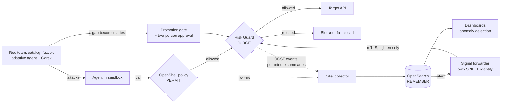

<!--
SPDX-FileCopyrightText: Copyright (c) 2026 Christopher Hanna.
SPDX-License-Identifier: Apache-2.0
-->

# The story: OpenShell, Risk Guard and OpenSearch as one loop

Three systems, one job: let an AI agent do real work without trusting it blindly.

| System | Whose | Role in the story |
|---|---|---|
| **OpenShell** | NVIDIA, open source | **Permits.** Runs each agent in a sandbox (Kata VM on AKS) and decides what it is allowed to reach: files, network, credentials. |
| **Risk Guard** | This project | **Judges.** For a call OpenShell would allow, asks "is this reasonable for this agent right now?" and can only say no. |
| **OpenSearch** (the SIEM; sometimes called "OpenStream" in conversation) | Open source | **Remembers and reacts.** Holds the evidence from both, shows it on dashboards, finds the unusual, and can ask Risk Guard to tighten. |

Beneath them: **SPIRE/SPIFFE** gives each service and sandbox a cryptographic identity, **Cilium** fences the network, and **Garak plus a red-team agent** try to break it. NVIDIA Sentry (planned hardware) is the layer this project does not replace; see [positioning](positioning.md).

## The loop

1. **Permit.** OpenShell checks the call against policy (`FinalAllow = OpenShellAllow ∧ RiskPermit`).
2. **Judge.** Risk Guard scores it at two gates, the supervisor middleware (before credentials are injected) and the egress tunnel (`ext_authz`). It refuses anything unusual for that workload, anything from a quarantined workload, and anything it cannot score. Detail: [architecture](architecture.md), [design](design.md).
3. **Remember.** Every refusal, every signal and a per-minute summary per workload leave Risk Guard as OCSF events beside OpenShell's own. They land in OpenSearch with the agent's name and SPIFFE identity. Detail: [SIEM guide](siem-guide.md), [SIEM integration](siem-integration.md).
4. **React.** An OpenSearch alert can ask Risk Guard to quarantine a workload for a bounded time. The request travels through a forwarder with its own identity over mTLS; it can only tighten. Detail: [SIEM signals](siem-signals.md).
5. **Change safely.** Loosening needs a second person ([two-person approval](two-person.md)). Moving from shadow to enforce needs evidence ([promotion gate](promotion-gate.md)). State can be backed up and restored ([recovery](recovery.md)).
6. **Prove.** The red-team catalog and fuzzer run in CI; an agent that attacks the live system turns any gap it finds into a permanent test ([red team](red-team.md), [red-team agent](red-team-agent.md)). Models for anomaly detection are trained and compared on synthetic traces ([ML training](ml-training.md)).

## Why each piece is there

- Without **OpenShell**, there is no boundary to narrow. Risk Guard never widens what it allows.
- Without **Risk Guard**, an agent can misuse an endpoint it is rightly allowed to reach (a `DELETE` where it should `GET`).
- Without **OpenSearch**, a refusal is a log line and nobody learns from it; with it, patterns across agents and time are visible and an alert can act.
- Without the **feedback path**, the SIEM can only watch. With it, detection can tighten control, but only in one direction and only through an authenticated, rate-limited, audited door.
- Without the **red team and the gates**, "it works" is a claim. With them, a gap is a failing build.

## What is real today, and what is not

Running on the AKS demo cluster: both gates, OCSF events and summaries in OpenSearch, the dashboards, signals through the forwarder (in dry-run), backup and restore (2.4 s and 56 s), two-person approval by CLI, the promotion gate (currently HOLD), the fuzzer (0 of 387 through) and one adaptive red-team run (17 requests, none through).

Also running (once deployed): an Approvals page in the console for two-person decisions and suggested baseline changes, three watch-only monitors, a "one call, both layers" search, and baseline suggestions drawn from SIEM history (a person signs any change).

Not yet: enforcement broadly switched on, Garak results, scheduled backups, a UI for approvals, signed images, hardware-backed trust. The full list is in [production gaps](production-gaps.md); the technical walk-through is in [how it works](how-it-works.md).

## Where things live in the repository

| Path | What it is | Part of the story |
|---|---|---|
| `src/detector/`, `src/normalizer/`, `src/store/` | Scoring, request canonicalisation, the SQLite state | Judge |
| `src/middleware_service.rs`, `src/interceptor_service.rs`, `src/ext_authz.rs` | The gRPC middleware, policy interceptor and tunnel gate | Judge (the two gates) |
| `src/ocsf.rs` | OCSF events and per-minute summaries | Remember |
| `src/signals.rs`, `src/signal_forwarder.rs` | Signals listener (token or mTLS+SPIFFE) and the forwarder | React |
| `src/store/changes.rs`, `src/backup.rs` | Two-person approval, backup and restore | Change safely |
| `src/operator_controls.rs`, `src/dashboard.rs`, `src/*_ui.html` | Operator console and API | Operate |
| `src/hardening/`, `src/adaptive*.rs`, `src/replay.rs` | Prover-checked tighter policies, learning, decision replay | Improve |
| `deploy/aks/` | Manifests and profiles for the AKS deployment | Deploy |
| `deploy/aks/siem/` | Collector, forwarder, NetworkPolicies | Remember, React |
| `deploy/aks/agents/`, `deploy/rail-guard-demo/` | The demo agents (and the red-team agent) and their policies | The agents under test |
| `scripts/aks/` | Numbered deploy scripts (`01`–`26`), in order | Deploy |
| `scripts/siem/`, `scripts/ml/` | Dashboards and alerts as code; anomaly-detection experiments | Remember, React |
| `scripts/redteam/`, `conformance/red-team/` | Red-team runner and ingest; catalog, discovered attacks, known fuzz gaps | Prove |
| `scripts/promotion_gate.py`, `deploy/aks/promotion-policy.json` | Shadow-to-enforce gate | Change safely |
| `scripts/conformance/`, `conformance/*.json` | Containment tests and their recorded reports | Prove |
| `tests/` | Integration tests (signals, mTLS, backup, two-person, red-team gate and fuzz) | Prove |
| `docs/` | This documentation; start here, then [how it works](how-it-works.md) | |

## Reading order

1. This page.
2. [How it works](how-it-works.md): the same loop in technical detail.
3. [Architecture](architecture.md) and [security model](security-model.md).
4. [Running on AKS](aks.md) to build it, [Getting started](getting-started.md) for lighter ways to try it.
5. [Partner demo](partner-demo.md) and [results sheet](results-sheet.md) for a meeting.
